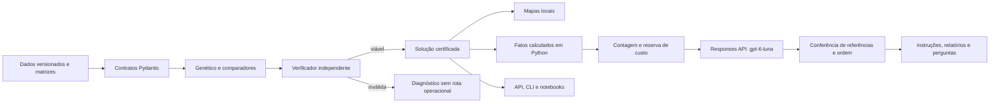

# Arquitetura e contratos

O pacote `rotas_medicas` concentra a lógica usada pela CLI, pelos notebooks e pela
API. Os cenários usam identificadores únicos, mesmo quando duas entregas têm a
mesma localização. A ordem dos nós das matrizes é depósito seguido pelas entregas.
As matrizes são direcionadas: o trajeto de ida pode diferir do retorno.

O indivíduo é uma permutação de índices de entregas e separadores de veículos.
A avaliação compara primeiro as violações estruturais, depois as violações de
capacidade/autonomia e, por último, o custo. Uma solução inválida não supera uma
válida por ter distância menor. A reparação tenta realocar e trocar entregas;
ela não garante encontrar uma solução para todo problema viável.

Para dados médicos, o custo é a distância em quilômetros somada a 0,05 vezes os
minutos de chegada ponderados por prioridade. O relógio de cada veículo começa
na mesma saída. O atendimento de uma parada afeta as chegadas seguintes. Não há
janelas de horário, coleta de carga nem prioridades clínicas validadas.

O verificador recalcula as métricas e restrições sem chamar o avaliador genético.
O oráculo enumera permutações e divisões de rotas em problemas pequenos. Uma
falha da busca retorna `no_feasible_solution`; `infeasible_proven` é reservado às
condições necessárias que realmente demonstram impossibilidade.

A API salva o cenário por hash e a solução por identificador. Ao recuperar uma
rota viável, faz nova certificação. A CLI usa arquivos JSON portáveis. Resultados
de experimentos incluem hashes do cenário e da implementação, semente, orçamento,
duração, configuração, histórico de convergência e condição de término.

O limite de 20.000 inclui todas as chamadas de fitness da busca: construção
inicial, população e candidatos de reparação. Há também um limite de 20.000
tentativas da população, para encerrar populações com alta repetição, e um limite
de 120 segundos. Custos de inserção de rotas parciais são contados separadamente;
a certificação final não é uma avaliação de busca. A melhor solução viável já
avaliada é preservada mesmo quando o orçamento termina durante a reparação.

A LLM recebe apenas fatos da solução certificada, nunca chaves ou dados clínicos.
Sua saída seleciona referências, organiza seções e identifica sequências de
veículos. Valores e frases factuais são renderizados pelo Python. Sugestões são
escolhidas de um vocabulário explícito de ações condicionais, sem simular novas
otimizações ou prometer efeitos clínicos. A utilidade depende de selecionar fatos
pertinentes; essa seleção é medida pelos casos fixos de avaliação.

O teto de US$ 1 é acumulado em SQLite, com transação de escrita antes de cada
chamada. Não há repetição automática do SDK. Timeout sem consumo conhecido
preserva a reserva. O cálculo usa US$ 0,125/milhão como limite conservador de
entrada, incluindo eventual escrita de cache, e US$ 0,50/milhão de saída. O consumo
retornado é reconciliado sem exceder o orçamento reservado. Respostas aceitas são
armazenadas com origem, modelo, prompt, hash dos fatos e consumo. Cache de teste
nunca constitui evidência de chamada real.

O esquema limita `instructions` a uma lista vazia nos demais tipos de pedido.
As referências são um enum dos fatos disponíveis no contexto. Isso evita IDs
inventados, mas não assegura pertinência; a rubrica confere a seleção necessária.
O hash do contrato inclui prompt, esquema, modelo e nível de raciocínio. A retomada
da avaliação e o cache exigem o mesmo contrato e contexto; uma revisão invalida
a evidência anterior. Rodadas reprovadas e seus consumos são preservados.
O cliente usa certificados confiáveis do sistema, inclusive o repositório ROOT
do Windows, mantendo conferência TLS da cadeia e do hostname.

## Rotas da API

| Método | Caminho | Finalidade |
|---|---|---|
| GET | `/health` | Saúde local |
| GET | `/v1/scenarios` | Cenários salvos |
| GET | `/v1/scenarios/{id}` | Contrato completo |
| POST | `/v1/optimizations` | Otimização e persistência |
| GET | `/v1/solutions/{id}` | Recuperação com conferência |
| POST | `/v1/solutions/{id}/instructions` | Sequência por veículo |
| POST | `/v1/solutions/{id}/daily-report` | Relatório diário |
| POST | `/v1/reports/weekly` | Relatório de até sete soluções |
| POST | `/v1/solutions/{id}/questions` | Pergunta fundamentada |

O Swagger está em `/docs`. A API escuta somente no endereço local por padrão.
Ela é uma aplicação acadêmica; autenticação de usuários e operação em produção
não foram incluídas neste escopo.
